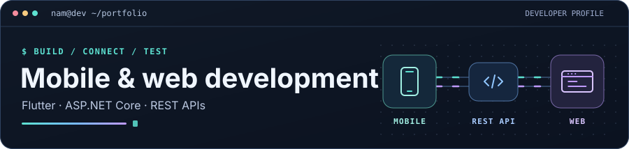

<h1 align="center">Hi, I'm Nguyễn Thành Nhất Nam 👋</h1>

<strong>Information Technology student at HUTECH · Flutter &amp; web development</strong>

## About me

I build Flutter interfaces that connect to APIs and cloud data. I also work on web features, from Vue templates and PDF exports to ASP.NET Core business logic and QA.

## Tech stack

| Area | Tools |
| --- | --- |
| **Mobile** | Flutter · Dart · Provider · SharedPreferences |
| **Web** | C# · ASP.NET Core · Vue.js · React |
| **Data & workflow** | Cloud Firestore · SQL Server · REST APIs · Git |

## Projects

| Project | My contribution | Stack |
| --- | --- | --- |
| **[GreenKitchen](https://github.com/nguyennhatnam213654-creator/GreenKitchen)** | Combined TheMealDB and approved Firestore recipes in one search experience. Built recipe submission and admin review. | Flutter · Dart · Firestore |
| **[SmartLib AI](https://github.com/nguyennhatnam213654-creator/LV23-088-Library-Revenue-AI)** | Implemented configurable overdue fines and built a four-sheet Excel export. Wrote test cases for library workflows. | React · C# · ASP.NET Core |
| **SmartCV AI** | Built 13 editable CV templates, fixed PDF layout issues, and developed the job posting and approval flow. | Vue.js · C# · ASP.NET Core |
